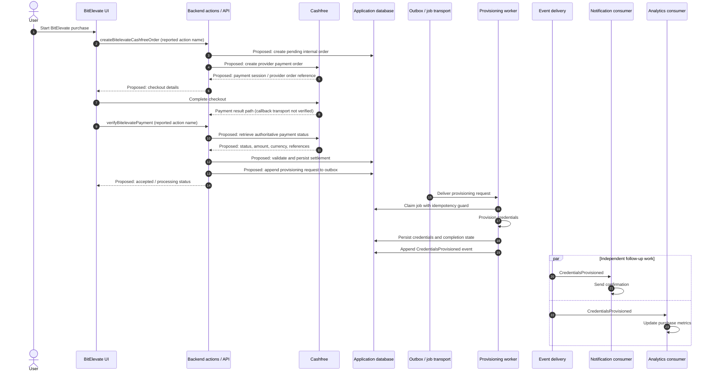
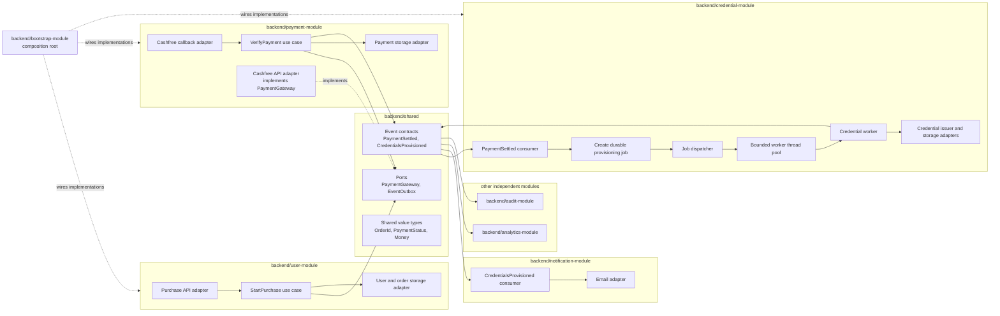

# Inferred Backend Architecture: BitElevate Purchase and Credential Provisioning

> **If the browser can show credentials after checkout, what should the backend prove before issuing them?**

**Explore the proposed design below.** This is an inferred architecture based on the client-side flow described in the [Detailed Audit Report](DETAILED_AUDIT.md); it is not a description of verified Cynbit internals.

The diagrams, module boundaries, data model, and Code snippets below are illustrative proposals. No application source code or server-side payment response was available to confirm them.

## 1. Proposed end-to-end workflow

The diagram separates the client-side sequence observed in the public bundle from server-side controls that remain unverified and the fulfilment design proposed below.

```mermaid
flowchart LR
    U[User] --> UI[BitElevate page<br/>publicly observed]
    UI --> A1[createBitelevateCashfreeOrder<br/>client action reference observed]
    A1 --> SID[Client reads paymentSessionId]
    SID --> SDK[Cashfree v3 browser SDK checkout]
    SDK --> RESULT[Checkout result returned to client]
    RESULT --> A2[verifyBitelevatePayment<br/>called with token and orderId]
    A2 --> SUCCESS[Client handles success result]
    SUCCESS --> DISPLAY[Dynamic credential values may be displayed or copied]

    subgraph NOTVERIFIED[Server-side behavior not verified]
        VERIFY[Provider status and payment details validation]
        MATCH[Order, amount, currency, applicant and replay checks]
        STORE[Credential issuance and storage]
        VERIFY --> MATCH --> STORE
    end
    A2 -. requires authorized source or runtime review .-> VERIFY

    subgraph PROPOSED[Proposed reliable fulfilment design]
        A2 -. verify provider state before fulfilment .-> PVERIFY[Provider-authoritative verification]
        PVERIFY --> CHECK[Validate status, order, amount and currency]
        CHECK --> SETTLE[Persist payment settlement]
        SETTLE --> O[(Transactional outbox)]
        O --> Q[Durable provisioning request]
        Q --> W[Idempotent worker]
        W --> C[Provision and store credentials]
        C --> CE[CredentialsProvisioned event]
        CE --> N[Notification consumer]
        CE --> AN[Analytics consumer]
        CE --> AL[Activity-log consumer]
        UI --> PORTAL[Authenticated intern portal]
        PORTAL --> OWN[Authorize user and ownership]
        OWN --> C
    end
```



### Proposed payment-to-credential sequence

This sequence is illustrative. It does not claim that the current system uses a webhook, queue, worker pool, database schema, or event bus.



## 2. Concrete multi-module layout

This is a proposed repository structure, not a claim about Cynbit’s existing source. Business capabilities are separate build modules. Shared ports and event contracts live in **backend/shared**; each feature keeps its own inbound and outbound adapters.



### Suggested repository structure

```text
backend/
├── shared/
│   └── src/main/java/.../contracts/
│       ├── ports/PaymentGateway.java
│       ├── ports/EventOutbox.java
│       ├── events/PaymentSettled.java
│       ├── events/CredentialsProvisioned.java
│       └── types/OrderId.java
├── user-module/
│   ├── api/
│   ├── application/
│   ├── domain/
│   └── adapters/persistence/
├── payment-module/
│   ├── api/
│   ├── application/
│   ├── domain/
│   └── adapters/cashfree-and-persistence/
├── credential-module/
│   ├── application/
│   ├── domain/
│   └── adapters/queue-issuer-and-storage/
├── notification-module/
│   └── adapters/event-consumer-and-email/
├── analytics-module/
│   └── adapters/event-consumer/
├── audit-module/
│   └── adapters/event-consumer-and-storage/
└── bootstrap-module/
    └── module-wiring/
```

### Request-to-consumer lifecycle

1. An authenticated HTTP request arrives at **user-module**. Its controller calls the purchase use case; the use case calculates the price from trusted data and calls the **PaymentGateway** port in **shared**.
2. The **payment-module** adapter implements that port with Cashfree. It creates the checkout session and returns only the session details needed by the client.
3. The provider callback enters through a payment-module adapter. The verification use case validates provider authenticity and payment details, then commits settlement and a **PaymentSettled** event to an outbox in one transaction.
4. An outbox relay publishes the event. A consumer in **credential-module** receives it and creates one durable provisioning job per order.
5. A dispatcher leases queued jobs and submits them to a bounded local thread pool. Each worker provisions one job, stores the result, marks the job complete, and appends **CredentialsProvisioned** to its outbox.
6. Independent consumers in **notification-module**, **analytics-module**, and **audit-module** receive the completion event and do their own work.

### Why this structure scales

- **Multi-module development:** Clear ownership and build boundaries help teams change one capability without depending on another feature’s implementation.
- **Hexagonal architecture:** Application logic calls ports; local adapters translate those calls to Cashfree, storage, HTTP, queues, or email. Business logic stays separate from infrastructure.
- **SOLID principles:** Keep each module focused on one responsibility; add provider implementations through adapters; keep ports small; require adapters to honor their port contracts; and make application services depend on abstractions.
- **Replaceable infrastructure:** Interfaces at boundaries let a database, provider SDK, broker, or email client change without spreading its types through business logic. Use interfaces where there is a real boundary or expected variation, rather than adding one to every class.
- **Independent event consumers:** Provisioning, notification, analytics, and audit work can fail and retry separately. Email delays do not block credential processing or analytics.
- **Lower-friction microservice extraction:** In one process, the composition root wires the shared PaymentGateway port to the Cashfree adapter. If payment becomes a separate service, user-module can wire the same port to a PaymentServiceHttpAdapter that calls the payment API; payment-service keeps its own Cashfree adapter. The purchase use case can keep its port while composition and infrastructure change. Shared event schemas also give separate services an explicit message contract. This reduces business-code changes; it does not make extraction change-free. Network failures, service authentication, observability, data ownership, eventual consistency, deployment, and distributed transactions still need design.

### Rate limits, job queues, and reliable delivery

- Apply rate limits to purchase creation and payment-verification requests using suitable account, order, and source limits. Do not let unauthenticated callers consume unlimited provider or worker capacity.
- Treat callbacks as untrusted until authenticity checks pass. Provider retries are normal, so callback processing and payment settlement must be idempotent.
- Persist a provisioning job after verified settlement. The durable queue can be a database-backed job table or a message broker; in either case, do not lose work when the API process exits.
- Use a bounded thread pool with limited concurrency and queue capacity. When full, leave jobs in the durable queue for later dispatch instead of dropping them.
- Retry transient failures with bounded backoff. Move exhausted or ambiguous jobs to a dead-letter or review state and support controlled re-drive.
- Use an outbox to commit payment settlement and its event together. Consumers should deduplicate repeated delivery.
- Give every event consumer its own retry and failure state.

## 3. Illustrative Java examples

Every snippet in this section is illustrative and incomplete. Suggested paths are shown for orientation only; they are not existing Cynbit files and have not been compiled against the application.

### 3.1 Handle a purchase request

Suggested path: **backend/user-module/src/main/java/.../api/PurchaseController.java**

The client selects a product. The server resolves the price and currency from trusted product data; it does not accept a client-supplied amount as authoritative.

```java
public record CreatePurchaseRequest(String productId) {}

public record PurchaseResponse(
        String orderId,
        String status,
        String checkoutUrl
) {}

@RestController
@RequestMapping("/api/purchases")
final class PurchaseController {
    private final PurchaseService purchases;

    PurchaseController(PurchaseService purchases) {
        this.purchases = purchases;
    }

    @PostMapping
    ResponseEntity<PurchaseResponse> create(
            @AuthenticationPrincipal AppUser user,
            @RequestBody CreatePurchaseRequest request,
            @RequestHeader("Idempotency-Key") String idempotencyKey) {
        PurchaseStarted result =
                purchases.start(user.id(), request.productId(), idempotencyKey);

        return ResponseEntity.accepted().body(new PurchaseResponse(
                result.orderId(),
                result.status().name(),
                result.checkoutUrl()));
    }
}
```

Suggested path: **backend/user-module/src/main/java/.../application/StartPurchaseService.java**

```java
final class StartPurchaseService {
    private final Orders orders;
    private final PaymentGateway paymentGateway;

    PurchaseStarted start(UserId userId, String productId, String idempotencyKey) {
        PurchaseOrder order = orders.createPendingFromCatalog(
                userId, productId, idempotencyKey);
        PaymentSession session = paymentGateway.createSession(
                new CreatePayment(order.id().value(), order.total(), order.returnUrl()));

        orders.attachProviderOrder(order.id(), session.providerOrderId());
        return new PurchaseStarted(order.id().value(), order.status(), session.checkoutUrl());
    }
}
```
The idempotency key should be scoped to the authenticated user and operation. Store a request fingerprint with it so that reusing a key with a different payload is rejected instead of silently returning an unrelated result.

### 3.2 Shared ports and the payment-module adapter

Shared contracts path: **backend/shared/src/main/java/.../contracts/ports/PaymentGateway.java**  
Adapter path: **backend/payment-module/src/main/java/.../adapters/cashfree/CashfreePaymentGateway.java**

```java
// Shared contract: provider SDK types do not cross this boundary.
public interface PaymentGateway {
    PaymentSession createSession(CreatePayment command);

    ProviderPayment inspectPayment(String providerOrderId);
}

public interface IntegrationEvent {
    UUID eventId();
}

public interface EventOutbox {
    void append(IntegrationEvent event);
}

public record CreatePayment(
        String merchantOrderId,
        Money amount,
        String returnUrl) {}

public record PaymentSession(
        String providerOrderId,
        String checkoutUrl) {}

public record ProviderPayment(
        String providerOrderId,
        String transactionId,
        Money amount,
        PaymentStatus status) {}

public record PaymentSettled(
        UUID eventId,
        String orderId,
        String paymentReference,
        String userId) implements IntegrationEvent {}

public record CredentialsProvisioned(
        UUID eventId,
        String orderId,
        String userId,
        String credentialReference) implements IntegrationEvent {}
```

```java
// This adapter lives in payment-module and implements a port from shared.
final class CashfreePaymentGateway implements PaymentGateway {
    private final CashfreeClient client;

    CashfreePaymentGateway(CashfreeClient client) {
        this.client = client;
    }

    @Override
    public PaymentSession createSession(CreatePayment command) {
        CashfreeOrder response = client.createOrder(
                command.merchantOrderId(),
                command.amount().minorUnits(),
                command.amount().currency(),
                command.returnUrl());
        return new PaymentSession(response.orderId(), response.paymentLink());
    }

    @Override
    public ProviderPayment inspectPayment(String providerOrderId) {
        CashfreeTransaction response = client.fetchFinalTransaction(providerOrderId);
        return new ProviderPayment(
                response.orderId(),
                response.transactionId(),
                Money.ofMinorUnits(response.amount(), response.currency()),
                mapStatus(response.status()));
    }
}
```

The user-module compiles against PaymentGateway in shared. It does not import the Cashfree SDK or payment-module implementation. The application composition root wires the interface to CashfreePaymentGateway at runtime.

### 3.3 Verify payment before settlement

Suggested path: **backend/payment-module/src/main/java/.../application/VerifyPaymentService.java**

```java
public VerificationResult verify(PaymentNotice notice) {
    // Verify a signed callback before trusting fields from it, when applicable.
    callbackAuthenticator.verify(notice);

    return transactionRunner.inTransaction(() -> {
        PurchaseOrder order = orders.requireByMerchantReference(notice.orderId());

        // A repeated success notification returns the existing result.
        if (payments.isSettledFor(order.id())) {
            return VerificationResult.alreadySettled(order.id());
        }

        ProviderPayment providerPayment =
                paymentGateway.inspectPayment(notice.providerOrderId());

        requireMatchingOrder(order, providerPayment, notice);
        requireMatchingAmountAndCurrency(order.total(), providerPayment.amount());

        if (providerPayment.status() != PaymentStatus.SUCCESS) {
            payments.recordObservedStatus(order.id(), providerPayment);
            return VerificationResult.notSettled(order.id(), providerPayment.status());
        }

        payments.settleOnce(order.id(), providerPayment);
        // Persist with the settlement transaction; relay asynchronously.
        outbox.append(new PaymentSettled(
                eventIds.next(),
                order.id().value(),
                providerPayment.transactionId(),
                order.userId().value()));

        return VerificationResult.settled(order.id());
    });
}
```

The exact repository, transaction, and callback types depend on the application. The important proposal is to verify provider-authoritative status, compare the expected order and amount, and commit settlement together with a durable event or outbox record. The outbox adapter implements the shared EventOutbox port and relays events only after commit.

### 3.4 Consume PaymentSettled and create a durable job

Suggested path: **backend/credential-module/src/main/java/.../application/PaymentSettledConsumer.java**

The message-broker adapter in credential-module subscribes to the shared PaymentSettled contract and calls this handler. The database job table is the durable work queue in this example; a unique order constraint and inbox key make redelivery safe.

```java
final class PaymentSettledConsumer {
    private final ProvisioningJobs jobs;
    private final ConsumerInbox inbox;
    private final TransactionRunner transactions;

    void on(PaymentSettled event) {
        transactions.inTransaction(() -> {
            if (inbox.alreadyProcessed("credential-module", event.eventId())) {
                return;
            }

            jobs.insertQueuedIfAbsent(
                    event.orderId(),
                    event.userId(),
                    event.paymentReference());

            inbox.markProcessed("credential-module", event.eventId());
        });
    }
}
```

A broker acknowledges the event after the database transaction commits. If the event is delivered again, the inbox and unique order constraint prevent a duplicate provisioning job. The job remains queued durably even if the API or consumer process stops.

### 3.5 Dispatch queued jobs to a bounded thread pool

Suggested path: **backend/credential-module/src/main/java/.../application/ProvisioningDispatcher.java**

The dispatcher leases queued jobs from durable storage, then submits each lease to a local ThreadPoolExecutor. Four core workers can grow to twelve when busy; the in-memory task queue is capped at 100. A saturated pool releases the lease so the durable job can be retried later instead of dropping it.

```java
final class ProvisioningDispatcher {
    private final ThreadPoolExecutor workers = new ThreadPoolExecutor(
            4,
            12,
            30,
            TimeUnit.SECONDS,
            new ArrayBlockingQueue<>(100),
            new ThreadPoolExecutor.AbortPolicy());

    private final ProvisioningJobs jobs;
    private final ProvisionCredentialsWorker worker;

    void dispatchBatch() {
        for (JobLease lease : jobs.leaseQueuedBatch(50)) {
            try {
                workers.execute(() -> worker.process(lease));
            } catch (RejectedExecutionException saturated) {
                jobs.releaseToQueue(lease);
                break;
            }
        }
    }
}
```

The database lease makes a job recoverable if a worker or process crashes. A scheduled dispatcher can reclaim expired leases. The bounded pool provides back-pressure; it should not replace the durable queue.

### 3.6 Process work and emit completion

Suggested path: **backend/credential-module/src/main/java/.../application/ProvisionCredentialsWorker.java**

The worker receives a lease already claimed by the dispatcher. It performs one idempotent provisioning operation, persists the credential and completed job state, and appends a completion event in the same transaction.

```java
public void process(JobLease lease) {
    ProvisioningJob job = jobs.requireValidLease(lease);
    if (job == null) {
        return; // Lease expired or job is no longer eligible.
    }

    try {
        CredentialResult result = issuer.provisionOnce(
                job.orderId(),
                job.userId(),
                job.idempotencyKey());

        transactionRunner.inTransaction(() -> {
            credentials.save(result.toCredential(job.userId(), job.orderId()));
            jobs.markCompleted(job.id());
            outbox.append(new CredentialsProvisioned(
                    eventIds.next(),
                    job.orderId().value(),
                    job.userId().value(),
                    result.credentialReference()));
        });
    } catch (TransientProvisioningException ex) {
        jobs.scheduleRetry(job.id(), retryPolicy.nextAttempt(job.attemptCount()));
    } catch (PermanentProvisioningException ex) {
        jobs.markNeedsReview(job.id(), safeErrorCode(ex));
    }
}
```

The issuer and persistence APIs are examples, not verified dependencies. If the external provisioning operation cannot be made idempotent, the implementation needs a reconciliation strategy for a worker that crashes after the external side effect but before saving its result.

### 3.7 Keep event consumers independent

Suggested paths: **backend/notification-module/src/main/java/.../application/CredentialsProvisionedConsumer.java** and **backend/analytics-module/src/main/java/.../application/CredentialsProvisionedConsumer.java**

```java
public void on(CredentialsProvisioned event) {
    // Use a consumer inbox / deduplication key before sending.
    if (inbox.alreadyProcessed(event.eventId())) {
        return;
    }
    mailer.sendCredentialsReadyNotice(event.userId(), event.orderId());
    inbox.markProcessed(event.eventId());
}
```

```java
public void on(CredentialsProvisioned event) {
    // This consumer has its own delivery and retry state.
    if (inbox.alreadyProcessed(event.eventId())) {
        return;
    }
    metrics.recordProvisioningCompleted(event.orderId());
    inbox.markProcessed(event.eventId());
}
```

Notification delivery should not hold up analytics, or vice versa. Consumers should be independently retryable and idempotent. Events should carry references and necessary metadata, not plaintext passwords, access tokens, or other secrets.

## 4. Proposed data model and state transitions

This is a suggested logical model. No schema was supplied for comparison.

| Entity | Example fields | Purpose |
|---|---|---|
| **purchase_order** | id, user_id, product_id, amount_minor, currency, status, idempotency_key, created_at | Records the intended purchase and server-calculated price. |
| **payment_attempt** | id, order_id, provider, provider_order_id, transaction_id, amount_minor, currency, status, verified_at | Tracks provider references and individual payment attempts. |
| **provisioning_job** | id, order_id, user_id, status, attempt_count, next_attempt_at, lease_until, completed_at | Tracks fulfilment independently from the HTTP request. |
| **credential** | id, order_id, user_id, encrypted_secret_or_reference, status, issued_at | Stores only the credential material or a secure reference needed for delivery. |
| **outbox_event** | id, aggregate_id, event_type, schema_version, payload, created_at, published_at | Reliably relays events committed with business state. |
| **consumer_inbox** | consumer_name, event_id, processed_at | Deduplicates at-least-once event delivery per consumer. |

Suggested constraints include a unique merchant order reference, unique provider transaction reference where the provider guarantees it, one active provisioning job per order, and a unique event id per consumer inbox. Model currency explicitly and store money in integer minor units or a well-defined decimal representation; do not use floating-point arithmetic for payment amounts.

Example state progression:

```text
Order:       PENDING_PAYMENT -> PAID -> FULFILLED
                          \-> CANCELLED / EXPIRED

Payment:     PENDING -> SUCCEEDED
                    \-> FAILED / CANCELLED

Provision:   QUEUED -> PROCESSING -> COMPLETED
                              \----> RETRY_WAIT -> PROCESSING
                              \----> NEEDS_REVIEW
```

Treat provider events as potentially delayed, duplicated, or out of order. Define allowed state transitions and make terminal transitions explicit. A failed payment attempt does not necessarily mean the overall order can never be paid; that depends on the business rules.

## 5. Reliability: idempotency, retries, and event delivery

### Idempotency

- Accept an idempotency key when creating a purchase and bind it to the authenticated user, operation, and request fingerprint.
- Deduplicate provider notifications using stable provider references and a unique database constraint.
- Make settlement idempotent: a repeated verified success returns the existing settlement.
- Allow at most one successful provisioning outcome per order unless the product explicitly supports multiple entitlements.
- Use a stable provisioning key when calling any external credential issuer.
- Deduplicate every event independently in each consumer.

### Retries and recovery

- Retry transient provider, database, queue, or downstream failures with bounded exponential backoff and jitter.
- Do not automatically retry permanent validation errors as if they were network failures.
- Keep retry counts, next-attempt times, and safe error codes on the job record.
- Move exhausted or ambiguous jobs to a review state or dead-letter queue; provide an operator reconciliation path.
- Use worker leases or visibility timeouts so a crashed worker's job can be reclaimed.
- Reconcile internal payment records with provider status to recover missed or delayed notifications.

### Transactional outbox

Writing “payment settled” to a database and publishing a message in a separate step can lose or duplicate the event if the process fails between those steps. A proposed outbox flow writes the business update and event row in one database transaction. A relay publishes unsent rows and marks them delivered; consumers tolerate redelivery through inbox deduplication.

The outbox improves reliability but does not provide magical exactly-once processing. The practical design is at-least-once delivery with idempotent state changes and consumer effects.

## 6. Security considerations and limits

The following are recommended checks, not claims that the current application fails them:

- Calculate price, currency, and eligible product on the server; never trust browser-submitted totals.
- Authenticate the user and verify ownership on every order and credential read.
- Verify provider webhook signatures using the provider's documented algorithm and secret handling. Where appropriate, query the provider API for final status as well.
- Match provider order reference, internal order, amount, currency, and final status before settlement.
- Keep provider secrets in managed secret storage or environment injection; rotate them and avoid logging them.
- Encrypt sensitive credential material at rest, restrict access, and avoid including secrets in events, logs, traces, analytics, or error messages.
- Return credentials only through an authenticated, authorized channel. Avoid placing them in URLs or unprotected notification content.
- Apply rate limits and abuse controls to purchase, verification, and credential retrieval endpoints.
- Use audit logs for sensitive state changes while redacting tokens, payment secrets, and credential values.

**Audit limitation:** The audit folder contains the evidence and finding records, but no application source code, deployment configuration, database schema, authenticated responses, webhook sample, or provider response was supplied. Server-side controls were not tested. The two confirmed findings are informational and evidence-limited; this report does not claim the application is vulnerable or secure.

## 7. Validation cases to consider

These are suggested validation cases for an implementation; they were not run as part of preparing this document.

| Area | Cases to cover |
|---|---|
| Purchase request | Unknown product, server-side price resolution, repeated idempotency key, same key with changed payload, unauthenticated request. |
| Payment verification | Valid success, pending result, failure, wrong order reference, wrong amount/currency, invalid signature, duplicate notification, out-of-order status. |
| Provisioning worker | Duplicate delivery, concurrent claim, crash before/after external side effect, transient retry, retry exhaustion, settled-payment precondition. |
| Event processing | Outbox relay restart, duplicate event, consumer outage, independent consumer retry, schema compatibility. |
| Credential access | Cross-user order ID, expired session, missing ownership, secret redaction, unauthorized access attempts. |
| Reconciliation | Provider says paid while local state is pending; local state says paid while provider reference is missing or ambiguous. |

## 8. Design takeaway

Static inspection of the public BitElevate bundle found references to **createBitelevateCashfreeOrder** and **verifyBitelevatePayment**. These indicate an intended Cashfree order-creation and payment-verification flow, but do not reveal the backend's internal architecture or prove how payment security is enforced.

For the proposed design, treat provider-confirmed settlement as the gate for fulfilment. Persist payment state and provisioning intent reliably, process credential work asynchronously and idempotently, and publish completion events for independent consumers. Keep cross-feature dependencies behind stable shared contracts, with adapters owned by their respective feature modules.

For observed findings and the exact scope, see the [Detailed Audit Report](DETAILED_AUDIT.md).